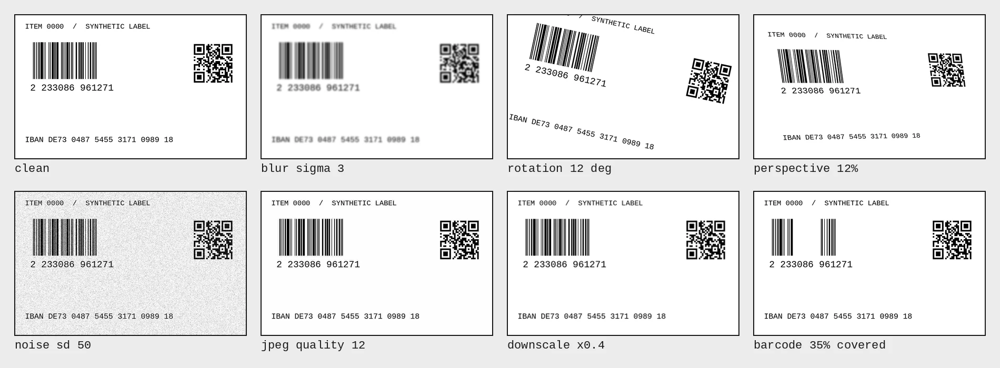
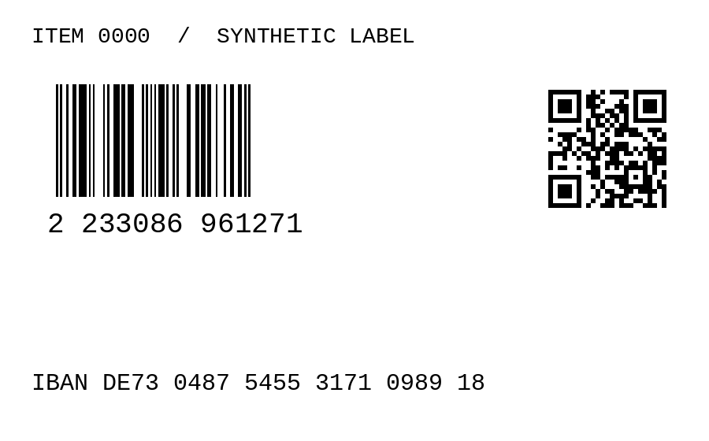
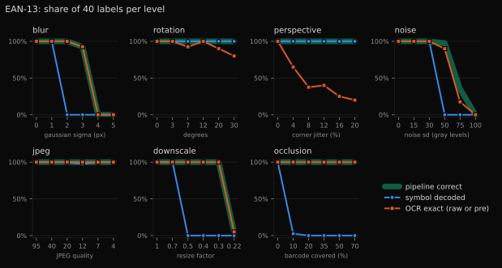
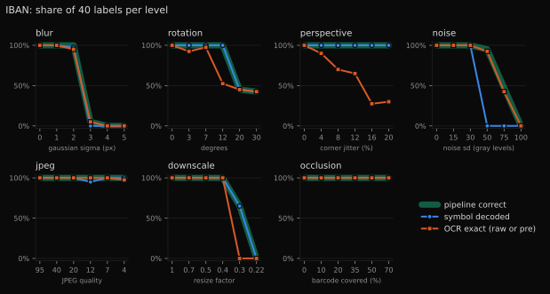
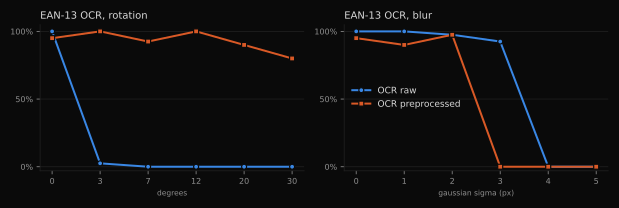

## Introduction

A lot of printed codes carry a check digit: product barcodes (EAN-13),
book numbers (ISBN), bank accounts (IBAN). I wanted to know how far I
can trust a pipeline that reads them from a photo, so I built one:
decode the barcode first, fall back to OCR on the printed digits, and
use the check digit to validate, or even repair, what OCR read.

The images are synthetic, so I always know the right answer. That let me
measure every step instead of guessing.

## Check digits in a nutshell

A check digit is one extra digit computed from the others. If any digit
is read wrong, the math stops adding up.

EAN-13 multiplies the first 12 digits by alternating weights 1 and 3,
and the 13th digit is whatever makes the total a multiple of 10:

```python
def gtin_check_digit(body: str) -> int:
    ds = [int(c) for c in body]
    # weights start at 3 from the rightmost body digit
    total = sum(d * (3 if i % 2 == 0 else 1) for i, d in enumerate(reversed(ds)))
    return (10 - total % 10) % 10
```

IBAN uses mod 97. Move the first four characters to the end, turn
letters into numbers (A = 10, B = 11, ...), and the whole thing must
leave remainder 1 (simplified, the repository also checks length per
country):

```python
def is_valid_iban(iban: str) -> bool:
    s = iban.replace(" ", "").upper()
    return _iban_to_int(s[4:] + s[:4]) % 97 == 1
```

Look at the output:

```sh
$ python
>>> gtin_check_digit("400638133393")
1
>>> is_valid_iban("GB82 WEST 1234 5698 7654 32")
True
```

What they guarantee is narrow. EAN-13 catches every single wrong digit,
and every swap of two neighbor digits, except when the two digits
differ by 5. Mod 97 catches every single wrong character and every
swap of two neighbor digits. Both are checked by the tests in the
repository, not just stated here.

## Generating the labels

Each label is drawn with PIL: an EAN-13 barcode with its digits printed
below, a QR code holding `IBAN:...`, and the IBAN printed as text.



Then each label gets one degradation at a time, at six levels: blur,
rotation, perspective, noise, JPEG compression, downscaling, and a
white band covering part of the barcode. 40 labels per level, 1680
images in total, all from a fixed seed. The same 40 labels are used for
every level, so a difference between levels isn't a difference between
labels.

## Barcode first

Decoding a symbol is cheap and has its own error detection, so it goes
first. `pyzbar` returns both the EAN-13 and the QR code:

```python
for sym in pyzbar.decode(img):
    data = sym.data.decode("ascii", errors="replace")
    if sym.type == "EAN13":
        out["ean"] = data
    elif sym.type == "QRCODE" and data.startswith("IBAN:"):
        out["iban"] = data[5:]
```

## OCR as fallback

When the symbol fails, the printed text is still there. I run Tesseract
twice, on the raw image and on a preprocessed one:

- upscale small images
- deskew by searching the angle where text lines are sharpest
- contrast and adaptive threshold
- remove the barcode bars with a vertical morphological opening

The bars matter more than I expected. Tesseract read them as
`999999999999` and, with `--psm 6`, sometimes returned nothing at all
for a perfectly clean label. Removing the bars and trying both `--psm 6`
and `--psm 11` fixed it.

An OCR read is only accepted if it passes its checksum.

## Read rates under degradation

Share of the 40 labels read correctly, per degradation level:



Notice how the barcode is the first thing to break. With blur sigma 2,
10% of the barcode covered, or the image at half size, pyzbar decodes
almost no EAN-13 (2.5% at 10% occlusion, 0% in the other two), while
OCR still reads the printed digits in 97.5% to 100% of the labels.

The IBAN, inside a QR code, behaves differently:



The QR code survives blur, occlusion and downscaling much better than
the barcode. It fails on more than half of the labels from 20 degrees of
rotation, and on all of them with noise of 50 gray levels, and that's
where the pipeline loses most IBANs.

Preprocessing isn't free either:



With 3 degrees of rotation, raw OCR reads 2.5% of the EAN-13s and the
preprocessed image reads 100%. With blur sigma 3 it flips: raw reads
92.5%, preprocessed reads 0%. That's why the pipeline keeps both
reads.

## Repairing from the checksum

When OCR reads something that fails the checksum, it's tempting to fix
it: try every single-digit change and keep the one that passes.

```python
from checkdigit_vision.domain.checksums import is_valid_ean13
from checkdigit_vision.domain.repair import fill_erasures, single_error_candidates

truth = "4006381333931"

# OCR could not read the 5th digit at all
print(fill_erasures("4006?81333931", is_valid_ean13))

# OCR read the 8th digit as 8 instead of 3
candidates = single_error_candidates("4006381833931", is_valid_ean13)
print(len(candidates), truth in candidates)
print(candidates[:4])
```

Look at the output:

```sh
$ python repair_demo.py
['4006381333931']
13 True
['4001381833931', '4006331833931', '4006381333931', '4006381833431']
```

When I know which digit is missing, there is exactly one answer. When I
don't know which digit is wrong, 13 different codes pass the checksum,
and nothing tells me which one was printed. One check digit is one
equation: it can solve one unknown, not find it.

So the pipeline only repairs when exactly one candidate is left. Here is
what each step added over the 1680 images:

| field | policy | correct | wrong | rejected |
|---|---|---:|---:|---:|
| EAN-13 | symbol only | 1040 | 0 | 640 |
| EAN-13 | + OCR (preprocessed) | 1423 | 0 | 257 |
| EAN-13 | + OCR (raw) | 1482 | 0 | 198 |
| EAN-13 | + checksum repair | 1492 | 12 | 176 |
| IBAN | symbol only | 1338 | 0 | 342 |
| IBAN | + OCR (preprocessed) | 1384 | 0 | 296 |
| IBAN | + OCR (raw) | 1397 | 1 | 282 |
| IBAN | + checksum repair | 1400 | 6 | 274 |

Notice how every step up to OCR only turns rejections into correct
reads. Repair is different: for EAN-13 it added 10 correct reads and 12
wrong ones.

11 of those 12 came from filling one unreadable digit, and the demo
above already shows why: with one erasure, the checksum always leaves
exactly one candidate, so "only one candidate" proves nothing. In all
12, OCR had also misread other digits it didn't flag, and the repair
built a valid code on top of them.

The one wrong IBAN accepted straight from OCR is a mod 97 collision,
under the heaviest noise:

```python
printed = "GB78AZTR29158378389299"
ocr = "GB78AZIR20158378385290"

print(is_valid_iban(printed), is_valid_iban(ocr))
print(sum(a != b for a, b in zip(printed, ocr)), "characters differ")
```

Look at the output:

```sh
$ python collision.py
True True
4 characters differ
```

Four characters wrong, and the checksum still closes. Beyond the errors
it was designed for, a check digit is a probability, not a guarantee.

## Notes

The labels are synthetic: one font, one layout, no paper texture, no
real lighting. The rates describe this setup, not every camera.

Perspective is the weak spot of the OCR side. The labels have no visible
edge, so there's nothing to rectify against, and OCR drops to 10% at the
strongest level. The symbols carry the pipeline there.

All numbers come from `results/` in the repository, and the results file
has the same hash on every run with the same seed.

## Conclusion

Read the symbol first, fall back to OCR, and accept only what passes the
checksum: on these images that combination made no wrong EAN-13 reads.
The check digit is very good at saying "this is wrong". Asking it to say
what's right is where the wrong answers came in.
